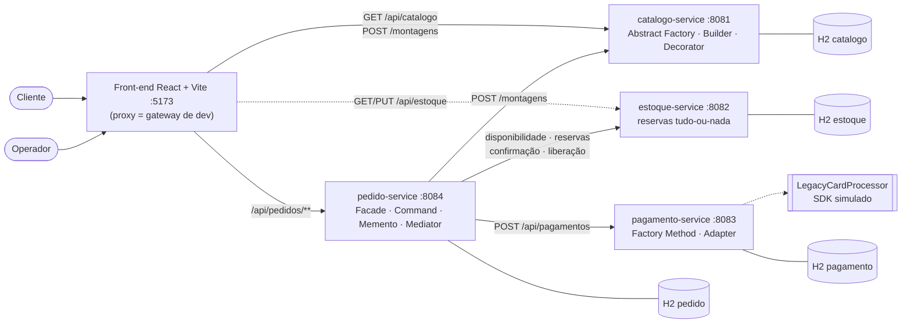
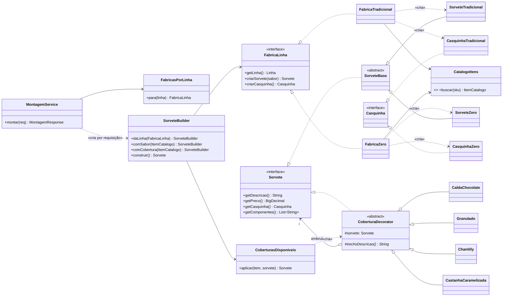
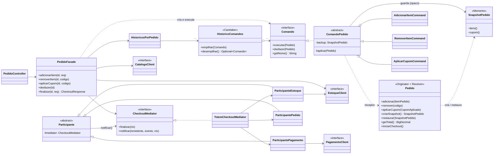
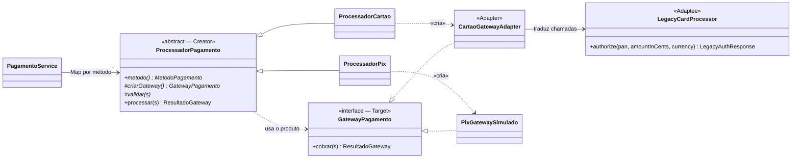
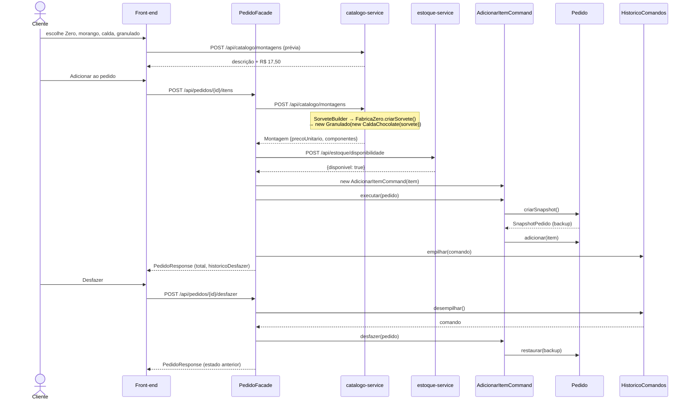
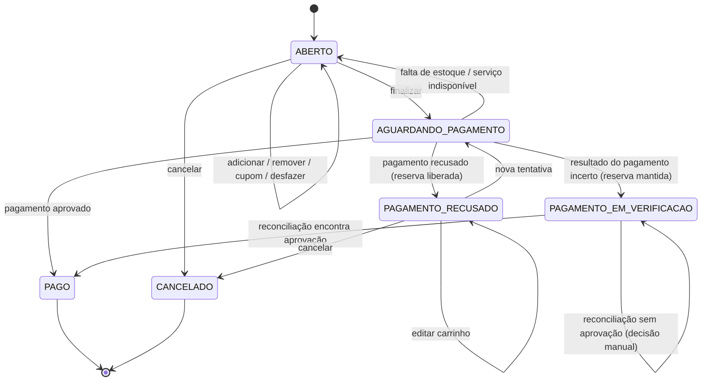

# Diagramas UML em Mermaid (editáveis)

Os blocos abaixo são renderizados pelo GitHub, VS Code (extensão Markdown Preview Mermaid) e
[mermaid.live](https://mermaid.live). Para levá-los ao Draw.io: **Arranjar → Inserir → Avançado → Mermaid** e colar o bloco.

Arquivos `.drawio` desta pasta: `arquitetura-microsservicos.drawio`, `casos-de-uso.drawio`,
`classes-padroes.drawio` (as 48 classes dos padrões nos 3 serviços) e `sequencia-checkout.drawio`. Os diagramas do projeto anterior estão preservados em `original/`.

## 1. Arquitetura (visão de componentes)

## 2. Classes — catalogo-service (Abstract Factory + Builder + Decorator)

## 3. Classes — pedido-service (Facade + Command + Memento + Mediator)

## 4. Classes — pagamento-service (Factory Method + Adapter)

## 5. Sequência — adicionar item e desfazer (Builder, Decorator, Command, Memento)

## 6. Estados do Pedido

